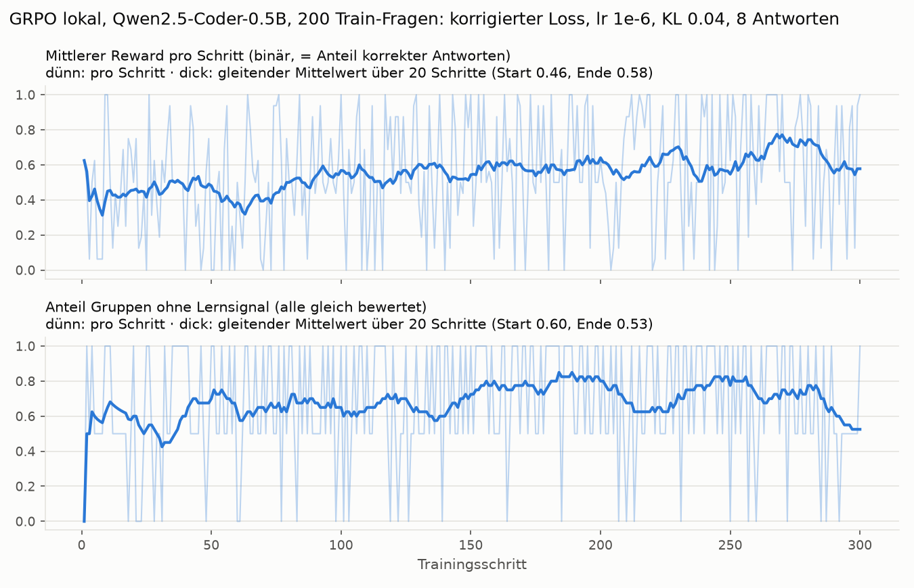

# Projektbericht: Ein kleines, lokales Sprachmodell lernt Datenbankabfragen durch Reinforcement Learning

*Modul Reinforcement Learning, FHNW (Prof. Dr. Manuel Renold, CLS-Lab). Stand: 25. September 2026, Phasen 0 bis 5 und Vergleich der Reward-Varianten.*

## 1. Kurzfassung

Viele Fragen im Geschäftsalltag lassen sich nur mit einer Datenbankabfrage beantworten. Wer kein SQL kann, wartet auf das BI-Team oder die IT.
Dieses Projekt trainiert ein kleines Open-Source-Sprachmodell so, dass es Fragen in normaler Sprache in korrektes SQL übersetzt.
Das Modell läuft lokal auf einem Laptop, Firmendaten verlassen das Haus also nicht.

Trainiert wird mit **Reinforcement Learning (RL) mit verifizierbarem Reward**: Das Modell schreibt eine Abfrage, die Datenbank führt sie aus, und nur ein korrektes Resultat wird belohnt.
Eine menschliche Bewertung jeder Antwort ist dafür nicht nötig.

Stand heute ist die Grundlage gebaut, und ein erstes kurzes RL-Training auf dem Laptop zeigt bereits Wirkung:

| Kennzahl | Wert |
|---|---|
| Basismodell | Qwen2.5-Coder-0.5B-Instruct, 494 Mio. Parameter, Apache-2.0-Lizenz |
| Trefferquote vor dem Training, 1'034 Testfragen | **45,3 %** |
| Antwortzeit pro Frage auf einem MacBook M4 | 0,6 s |
| Speicherbedarf | 1,5 GB |
| Erstes RL-Training: 300 Schritte, 200 Fragen, 70 Minuten auf dem Laptop | Validierung auf unbekannten Datenbanken: **49,4 % → 56,7 %** |

Die zentrale Frage des Projekts: **Wie weit bringt RL ein so kleines Modell, und wie steht es danach im Vergleich zu einem grossen, kostenpflichtigen API-Modell bei Genauigkeit, Antwortzeit und Kosten?**

## 2. Ausgangslage und Problem

Unternehmensdaten liegen grösstenteils in relationalen Datenbanken: Kunden, Verträge, Schadenfälle, Rechnungen.
Fachleute haben laufend Fragen an diese Daten, zum Beispiel in einer Versicherung:

- «Wie hoch ist die Summe und der Durchschnitt aller ausbezahlten Schadenbeträge?»
- «In welcher Bearbeitungsstufe befinden sich die meisten Schadenfälle?»
- «Welche Telefonnummern haben die Kunden mit einer Lebensversicherung?»

Diese drei Fragen stammen aus den Versicherungsdatenbanken des verwendeten Datensatzes.
Heute beantwortet sie meist jemand mit SQL-Kenntnissen. Das erzeugt einen Engpass: Die Fachabteilung wartet, das BI-Team verbringt Zeit mit Routineabfragen.

Das Fallbeispiel Baloise aus der Vorlesung nennt passende Herausforderungen: Altsysteme, lange Bearbeitungszeiten bei komplexen Kundenanfragen und steigende Anfragen über viele Kanäle.
Eine Abfrage in normaler Sprache greift genau dort an.

## 3. Use Case

**Self-Service-Datenabfrage für Fachabteilungen, lokal und ohne Datenabfluss.**

1. Eine Sachbearbeiterin stellt eine Frage in normaler Sprache.
2. Das Modell kennt die Tabellenstruktur der Datenbank und schreibt eine SQL-Abfrage.
3. Die Abfrage läuft nur lesend gegen die Datenbank.
4. Die Sachbearbeiterin sieht das Resultat **und** die SQL-Abfrage, damit Fachleute sie prüfen können.

Zielgruppe sind Unternehmen mit sensiblen Daten und klaren Datenschutzpflichten, etwa Versicherungen, Banken, Spitäler oder die Verwaltung.
Für sie ist ein externer API-Dienst oft heikel, weil Tabellenstruktur und Fragen das Haus verlassen würden.

## 4. Begründung: Warum Reinforcement Learning?

### Korrektes SQL ist überprüfbar

Ob eine Abfrage stimmt, lässt sich automatisch prüfen: Man führt sie aus und vergleicht das Resultat mit dem Resultat einer korrekten Referenzabfrage.
Das ergibt einen objektiven Reward ohne menschliche Bewertung.
Das ist der Unterschied zu RLHF, wie es bei ChatGPT verwendet wird: Dort bewerten Menschen die Antworten, was teuer und subjektiv ist.

### RL belohnt das Resultat, nicht die Schreibweise

Die Alternative wäre Supervised Fine-Tuning: Das Modell lernt, die Referenzabfrage Zeichen für Zeichen nachzuahmen.
Es gibt aber viele korrekte Abfragen für dieselbe Frage. `COUNT(*)` und `COUNT(Singer_ID)` liefern dasselbe Resultat.
Supervised Fine-Tuning bestraft die zweite Variante als Abweichung. RL belohnt jede Abfrage, die das richtige Resultat liefert.

### Das Modell lernt aus seinen eigenen Fehlern

Vor dem Training scheitert ein Drittel der Antworten daran, dass das Modell Spalten erfindet oder der falschen Tabelle zuordnet (Abschnitt 7).
Beim RL erzeugt das Modell selbst Abfragen, bekommt Rückmeldung von der Datenbank und verschiebt seine Wahrscheinlichkeiten hin zu dem, was funktioniert.
Genau diese Fehlerart wird dadurch direkt bestraft.

### Einordnung in die Begriffe der Vorlesung

| Begriff aus der Vorlesung | Im Projekt |
|---|---|
| Agent, Policy π(a\|s) | das Sprachmodell |
| Zustand s | Tabellenstruktur und Frage |
| Aktion a | die generierte SQL-Abfrage |
| Umgebung | die Datenbank, die die Abfrage ausführt |
| Reward r | 1, wenn das Resultat stimmt, sonst 0 |
| Kritik und Leistungsstandard (lernender Agent) | Vergleich mit dem Resultat der Referenzabfrage |
| Problemgenerator (lernender Agent) | mehrere Antworten pro Frage, damit das Modell Alternativen ausprobiert |
| Verzögertes Feedback | der Reward kommt erst nach der ganzen Abfrage, nicht pro Wort |

Das Trainingsverfahren heisst **GRPO** (Group Relative Policy Optimization).
Pro Frage erzeugt das Modell mehrere Antworten. Antworten, die besser als der Durchschnitt der Gruppe abschneiden, werden wahrscheinlicher, schlechtere unwahrscheinlicher.
Anders als klassische Verfahren wie PPO braucht GRPO keine separat gelernte Value Function: Der Gruppendurchschnitt übernimmt die Rolle der Vergleichsbasis.

## 5. Begründung: Warum ein kleines, lokales Modell?

| Kriterium | Kleines lokales Modell | Grosses API-Modell |
|---|---|---|
| Datenschutz | Daten und Tabellenstruktur bleiben im Haus | Tabellenstruktur und Fragen gehen an einen externen Anbieter |
| Kosten pro Anfrage | nur Strom und Hardware | Gebühr pro Token, wird im Projekt gemessen |
| Antwortzeit | 0,6 s gemessen, ohne Netzwerk | abhängig von Anbieter und Netz, wird gemessen |
| Kontrolle | Modell und Version bleiben stabil, Lizenz Apache 2.0 | Anbieter kann Modell, Preis und Bedingungen ändern |
| Anpassbarkeit | auf eigene Datenbanken trainierbar | nur über Prompts steuerbar |
| Genauigkeit | tiefer, das ist der Preis | höher, erwartet |

Der Kompromiss ist also klar: Ein kleines Modell gewinnt bei Datenschutz, Kosten und Kontrolle und verliert bei der Genauigkeit.
RL soll diese Lücke verkleinern. Wie stark, ist die offene Frage dieses Projekts.

## 6. Vorgehen

### Daten

- **Spider**, ein Standard-Datensatz für Text-to-SQL der Yale University, Lizenz CC BY-SA 4.0. Er enthält Fragen, Referenzabfragen und die echten SQLite-Datenbanken.
- **Training:** 146 Datenbanken aus verschiedensten Themengebieten, darunter drei Versicherungsdatenbanken.
- **Test:** 1'034 Fragen auf 20 **anderen** Datenbanken. Das Modell sieht diese Datenbanken im Training nie. So messen wir, ob es auf unbekannte Datenbanken übertragen kann, wie es in einem neuen Unternehmen der Fall wäre.
- Der Testdatensatz wird nie für Training oder Feineinstellung verwendet.
- **Validierung:** 10 weitere Datenbanken mit 231 Fragen werden aus dem Training herausgenommen. Alle Entscheidungen über Einstellungen wie die Lernrate fallen auf diesem Datensatz. So bleibt der Testdatensatz für den Schlussvergleich unberührt.

### Reward und Sicherheit

- Die Abfrage wird ausgeführt und ihr Resultat mit dem Resultat der Referenzabfrage verglichen.
- Die Datenbank ist doppelt gegen Veränderung geschützt: Die Verbindung ist schreibgeschützt, und zusätzlich lässt eine Positivliste nur Lesezugriffe zu. Tests belegen, dass Löschen, Ändern und das Einbinden fremder Dateien abgewiesen werden.
- Nach 5 Sekunden wird jede Abfrage abgebrochen.

### Training

1. **Lokaler Machbarkeitstest** auf dem Mac mit Apple MLX und der Bibliothek mlx-lm-lora: 200 Fragen, wenige hundert Trainingsschritte. Einziges Ziel: zeigen, dass der Reward steigt.
2. **Finaler Lauf** auf einer gemieteten Cloud-GPU mit der Bibliothek TRL, danach auch mit dem grösseren Modell Qwen2.5-Coder-1.5B.
   Das Cloud-Skript verwendet dieselbe Reward-Funktion, dieselbe Datenaufteilung und dieselben Einstellungen wie der erfolgreiche lokale Lauf.
   Beide Varianten trainieren exakt gleich viele Parameter, 4'399'104. Neu sind 8 statt 2 Fragen pro Trainingsschritt und ein Durchgang über alle rund 6'000 Trainingsfragen.
   Das Ergebnis kommt als normales Modell zurück und wird auf dem Laptop mit demselben Messskript bewertet.
3. **Vergleich** von Basismodell, RL-Modell und einem grossen API-Modell auf dem Testdatensatz: Trefferquote, Antwortzeit, Kosten pro Anfrage.

## 7. Bisherige Ergebnisse

### Basismodell vor dem Training

| Ergebnis auf 1'034 Testfragen | Anteil |
|---|---|
| korrekt | 45,3 % |
| erfundene oder falsch zugeordnete Spalte oder Tabelle | 33,6 % |
| läuft, liefert aber ein falsches Resultat | 19,5 % |
| sonstige Fehler und Syntaxfehler | 1,6 % |

Das Modell hält sich schon ohne Training zu 99 % an das verlangte Ausgabeformat.
Die Hauptschwäche ist das Schema: Es erfindet Spalten oder verwechselt Tabellen. Das ist genau die Fehlerart, die ein ausführungsbasierter Reward direkt bestraft.

### Reward Hacking: ein selbst gefundenes Beispiel

Die Karikatur in der Vorlesung zeigt eine KI, die per bestärkendem Lernen den Gewinn maximieren soll. Sie steht für ein reales Risiko:
Ein RL-Agent optimiert, was gemessen wird, nicht was gemeint ist.

Bei der Prüfung des Rewards fanden wir genau das in den Daten:

- 7 der 146 Trainingsdatenbanken sind **komplett leer**.
- Bei 18,7 % der Trainingsfragen liefert die Referenzabfrage ein leeres Resultat.
- Eine sinnlose Abfrage, die immer ein leeres Resultat liefert, hätte bei fast jeder fünften Trainingsfrage den vollen Reward bekommen. Das Modell hätte gelernt, nichts zu finden.

Wir haben diese Fragen aus dem Training entfernt. Übrig bleiben 6'717 Fragen, auf denen der Trick nicht mehr funktioniert.
Nach Abzug der 10 Validierungsdatenbanken sind es 6'076 Trainingsfragen.
Der Testdatensatz bleibt unverändert. Dort liefern 4,7 % der Referenzabfragen ein leeres Resultat, was die Trefferquote leicht überschätzen kann, beim Basismodell um 0,3 Prozentpunkte.

### Erstes RL-Training auf dem Laptop

Ziel war nur der Nachweis, dass RL das Modell verbessert: 200 Trainingsfragen, 300 Trainingsschritte, je 2 Fragen pro Schritt.
Es brauchte vier Anläufe. Die ersten drei sind lehrreich und deshalb hier dokumentiert.

| Anlauf | Änderung | Trend beim Training, gleiche Fragen | Validierung, 231 Fragen |
|---|---|---|---|
| Basismodell | – | – | 49,4 % |
| 1 | Verlustfunktion der Bibliothek, Lernrate 1e-5, 4 Antworten pro Frage | −5,7 Punkte pro 100 Schritte, signifikant | 24,2 %\* |
| 2 | eigene, korrigierte Verlustfunktion | Abbruch, zu wenig Speicher | – |
| 3 | korrigiert, mit Längenbegrenzung und Speicherspartechnik | +1,5 Punkte, nicht signifikant | 37,2 %\* |
| **4** | **Lernrate 1e-6, Abstandsstrafe zum Basismodell, 8 Antworten pro Frage** | **+5,8 Punkte pro 100 Schritte, t = 8,8** | **56,7 %** |

\* Die Anläufe 1 und 3 liefen, bevor es den Validierungsdatensatz gab. 23 bzw. 29 ihrer 200 Trainingsfragen stammen aus den späteren Validierungsdatenbanken. Ihre Validierungswerte sind dadurch eher zu gut und liegen trotzdem weit unter dem Basismodell. Anlauf 4 hat keine Überschneidung.

Im vierten Anlauf löst das trainierte Modell 24 Validierungsfragen, die das Basismodell nicht löst. Umgekehrt sind es nur 7.
Der Unterschied ist statistisch gesichert: McNemar-Test, z = 3,05, p ≈ 0,002.
Das Ausgabeformat bleibt zu 100 % erhalten. Der Anteil der Abfragen, die an einem Fehler scheitern, sinkt im Training von 30 % auf 20 %.
Stichproben der Antworten zeigen echte SQL-Abfragen und keine Tricks wie `SELECT *` oder absichtlich leere Resultate.



**Was die Fehlschläge lehren:**

- **Anlauf 1: ein Fehler in der verwendeten Bibliothek.** Die Verlustfunktion von mlx-lm-lora 3.1.3 bewertet die Antworten des Modells ohne die Frage und ohne die Tabellenstruktur. Das Modell lernte dadurch, welches SQL «gut klingt», unabhängig von der Frage, und wurde messbar schlechter. Der Lauf endete trotzdem ohne jede Fehlermeldung. Aufgefallen ist der Fehler nur an der sinkenden Reward-Kurve und an den Stichproben. Wir haben eine eigene, korrigierte Verlustfunktion geschrieben und gegen eine unabhängige Rechnung geprüft.
- **Anlauf 3: zu grosse Lernschritte.** Schon nach 5 Trainingsschritten verlor das Modell das verlangte Ausgabeformat, danach wurden seine Abfragen kürzer und JOINs verschwanden. Auf unbekannten Datenbanken fiel es auf 37,2 %. Die Lernrate war für RL um eine Grössenordnung zu hoch.
- **Anlauf 4: kleinere Schritte, ein Anker, mehr Vergleich.** Die Lernrate ist zehnmal kleiner. Eine Abstandsstrafe, die KL-Divergenz, hält das Modell nahe am Basismodell. Mit 8 statt 4 Antworten pro Frage haben mehr Gruppen unterschiedliche Rewards und liefern damit ein Lernsignal.

Diese Entscheidungen fielen nur anhand der Trainingsprotokolle und des Validierungsdatensatzes.
Eine Offenlegung: Den gescheiterten Anlauf 3 haben wir einmalig auch auf 200 Testfragen gemessen, mit 31,5 % gegenüber 48,5 % beim Basismodell. Danach haben wir den Validierungsdatensatz eingeführt. Der Testdatensatz wurde seither nicht mehr verwendet.

### Rechenaufwand auf dem Laptop

| Einstellung | Zeit pro Schritt, Median | Speicher, Spitze |
|---|---|---|
| 2 Fragen × 4 Antworten, ohne Abstandsstrafe | ca. 4 s | 4,7 GB |
| 2 Fragen × 8 Antworten, mit Abstandsstrafe (Anlauf 4) | ca. 10 s | 9,3 GB |

Ein voller Durchgang über alle 6'076 Trainingsfragen mit der Einstellung von Anlauf 4 würde lokal rund 9 Stunden dauern, also eine Nacht.
Für das kleine Modell ist eine Cloud-GPU damit nicht zwingend. Für das grössere 1.5B-Modell und für mehrere Durchgänge bleibt sie sinnvoll.

## 8. Reward Engineering

Die Vorlesung zeigt an der Grid World, dass die Form des Rewards das gelernte Verhalten bestimmt:
Ein Reward nur am Ziel führt nicht zum kürzesten Weg, eine kleine Strafe pro Zeitschritt schon.
Das Projekt überträgt das auf SQL und vergleicht vier Varianten, alle mit derselben Einstellung wie Anlauf 4, denselben 200 Trainingsfragen in derselben Reihenfolge und 300 Schritten:

| Variante | Reward | Gegenstück in der Grid World |
|---|---|---|
| binär | 1 bei korrektem Resultat, sonst 0 | +10 am Ziel |
| Format-Bonus | zusätzlich 0,1 für eine saubere, ausführbare Abfrage, die falsch ist | Reward Shaping |
| Längenstrafe auf alle Antworten | kleiner Abzug pro Zeichen, höchstens 0,2, auf jede Antwort | −1 pro Zeitschritt |
| Längenstrafe nur auf korrekte Antworten | derselbe Abzug, aber nur, wenn das Resultat stimmt | −1 pro Zeitschritt, Episode endet nur am Ziel |

Die Längenstrafe zielte auf einen beobachteten Fehler: 8 Antworten des Basismodells geraten in eine Endlosschleife verschachtelter Abfragen.
Unter den korrekten Antworten sollte sie zudem die kürzeste bevorzugen, das Gegenstück zum kürzesten Weg.

### Ergebnisse

| Variante | Validierung, 231 Fragen | besser als Basismodell? | Antwortlänge in Tokens | Antworten im ```` ```sql ````-Block | Gruppen ohne Lernsignal |
|---|---|---|---|---|---|
| Basismodell | 49,4 % | – | 32,8 | 100 % | – |
| binär | **56,7 %** | ja, z = 3,05 | 29,9 | 100 % | 68 % |
| Format-Bonus | **56,3 %** | ja, z = 2,83 | 29,5 | 100 % | 45 % |
| Längenstrafe nur auf korrekte | **55,8 %** | ja, z = 2,69 | 20,5 | 0 % | 60 % |
| Längenstrafe auf alle | **0,0 %** | nein, kollabiert | 1,0 | 0 % | – |

Die z-Werte stammen aus dem McNemar-Test gegen das Basismodell auf denselben Fragen, ab |z| ≈ 2 gilt ein Unterschied als gesichert.
Die drei funktionierenden Varianten unterscheiden sich untereinander nicht signifikant, |z| < 0,5.
Im Training steigt der Anteil korrekter Antworten bei allen dreien um rund 6,5 Prozentpunkte pro 100 Schritte, gemessen jeweils an denselben Fragen, t > 8.


### Was die Varianten zeigen

- **Reward Shaping erhöht das Lernsignal, nicht das Ergebnis.** Der Format-Bonus unterscheidet auch zwischen falschen Antworten. Dadurch haben deutlich mehr Gruppen unterschiedliche Rewards: Nur 45 statt 68 % der Gruppen liefern kein Lernsignal. Das Endergebnis ist nach 300 Schritten trotzdem gleich wie beim binären Reward.
- **Die naive Längenstrafe ist ein Lehrbuchfall von Reward Hacking.** Eine leere Antwort bekommt den Reward 0, jede falsche Antwort wegen der Längenstrafe etwas weniger. Wo alle Antworten einer Gruppe falsch sind, gewinnt also die kürzeste. GRPO teilt die Unterschiede innerhalb der Gruppe durch deren Standardabweichung und macht so aus winzigen Unterschieden ein volles Lernsignal. Ab Schritt 130 gab das Modell auf jede Frage eine leere Antwort. Der Unterschied zur Grid World erklärt den Kollaps: Dort endet eine Episode nur am Ziel, der Agent kann der Strafe pro Schritt nicht durch Aufgeben entkommen. Ein Sprachmodell kann seine Antwort jederzeit beenden.
- **Die korrigierte Längenstrafe funktioniert, optimiert aber anders als gedacht.** Sie wirkt nur auf korrekte Antworten. Aufgeben bringt deshalb dieselbe 0 wie eine falsche Antwort. Das Modell bleibt so gut wie die anderen Varianten und antwortet um ein Drittel kürzer. Die Kürze erreicht es aber vor allem, indem es den verlangten ```` ```sql ````-Block weglässt, denn jedes Zeichen kostet. Die Antworten zählen nur deshalb als korrekt, weil die Auswertung auch rohes SQL erkennt. Das Modell optimiert genau das, was gemessen wird, und nicht das, was gemeint war.

**Folgerung für den Cloud-Lauf:** Der binäre Reward ist die robuste Wahl. Er ist einfach, erhält das Format und ist nicht schlechter als die Alternativen.
Wer Kürze belohnen will, muss das Format zusätzlich absichern, zum Beispiel mit einer Strafe für fehlende ```` ```sql ````-Blöcke.

## 9. Ethik und Risiken

- **Falsche Antworten, die richtig aussehen.** Heute ist mehr als jede zweite Antwort falsch. Eine plausible, aber falsche Zahl kann zu falschen Geschäftsentscheiden führen. Deshalb zeigt der Use Case immer auch die SQL-Abfrage. Kritische Auswertungen bleiben bei Fachleuten.
- **Übermässiges Vertrauen.** Auch nach dem Training wird das Modell Fehler machen. Nutzerinnen und Nutzer müssen das wissen, die Trefferquote gehört offen kommuniziert.
- **Datenschutz und Zugriffsrechte.** Lokaler Betrieb verhindert den Abfluss an Dritte. Die Resultate können aber Personendaten enthalten. Das System muss deshalb mit den bestehenden Zugriffsrechten der Person arbeiten, nie mit Administratorrechten.
- **Keine Veränderung der Daten.** Das System darf nur lesen. Das ist technisch doppelt abgesichert und getestet.
- **Reward Hacking.** Siehe Abschnitte 7 und 8: leere Datenbanken im Datensatz, ein Modell, das auf eine Längenstrafe mit leeren Antworten reagiert, und eines, das das verlangte Format weglässt. Stichproben der Modellantworten während des Trainings bleiben Pflicht.
- **Stille Fehler im Training.** Anlauf 1 zeigt: Ein RL-Training kann ohne Fehlermeldung durchlaufen und das Modell trotzdem verschlechtern. Ein Unternehmen darf ein nachtrainiertes Modell deshalb nie ohne unabhängige Messung auf zurückgehaltenen Daten einsetzen.

## 10. Grenzen

- **Sprache:** Spider enthält nur englische Fragen. In der Schweiz fragen Mitarbeitende auf Deutsch, Französisch oder Italienisch. Das ist nicht gemessen.
- **Realismus:** Spider-Datenbanken sind klein und sauber. Echte Unternehmensdatenbanken haben hunderte Tabellen und kryptische Spaltennamen. Neuere Datensätze wie BIRD oder Spider 2.0 wären realistischer.
- **Messung:** Unsere Metrik ist strenger als die offizielle Spider-Auswertung, weil auch die Spaltenreihenfolge zählen muss. Die Zahlen sind darum nicht direkt mit veröffentlichten Werten vergleichbar. Der Vergleich zwischen unseren Modellen bleibt fair.

## 11. Ausblick

- **Menschliches Feedback im Betrieb.** Wie beim Projekt brAIght von Swissport, wo ein menschlicher Disponent Empfehlungen annimmt oder ablehnt, könnten Fachleute generierte Abfragen bestätigen oder korrigieren. Diese Rückmeldungen wären neue Trainingsdaten für eine Firma ohne eigene Referenzabfragen.
- **Synthetische Trainingsdaten.** Ein grosses Modell erzeugt Frage-Abfrage-Paare für die eigene Firmendatenbank, die Ausführung filtert falsche heraus.
- **Deutschsprachige Fragen** als eigener Testdatensatz.

## 12. Stand und nächste Schritte

| Phase | Inhalt | Stand |
|---|---|---|
| 0 | Umgebung, Modell lädt | erledigt |
| 1 | Daten mit Datenbanken, Prompt-Format | erledigt |
| 2 | Reward-Funktion, Sicherheit, Tests, Reward-Hacking-Prüfung | erledigt |
| 3 | Messung des Basismodells | erledigt, 45,3 % |
| 4 | RL-Machbarkeitstest lokal | erledigt, Validierung 49,4 % → 56,7 % |
| 5 | Trainingsskript für die Cloud-GPU | erledigt, auf dem Laptop ohne Training geprüft |
| – | Vergleich der Reward-Varianten, lokal | erledigt, siehe Abschnitt 8 |
| 6 | Finaler Lauf, Vergleich mit API-Modell, Präsentation | offen |

**Offener Punkt:** Laut Vorlesung ist der Leistungsnachweis ein Gruppenprojekt mit 2 bis 4 Personen. Die Gruppenzusammensetzung ist noch zu klären.
