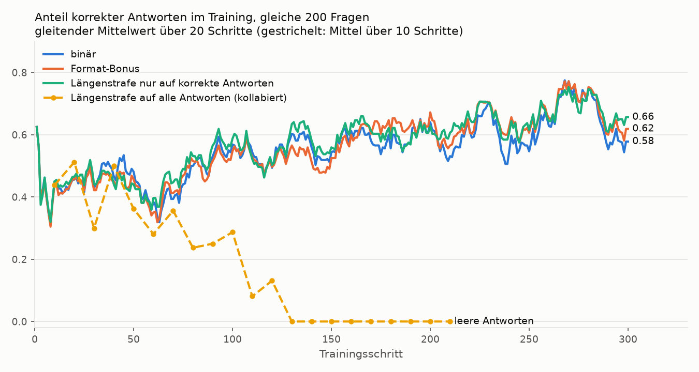

# Projektbericht: Ein kleines, lokales Sprachmodell lernt Datenbankabfragen durch Reinforcement Learning

*Modul Reinforcement Learning, FHNW (Prof. Dr. Manuel Renold, CLS-Lab). Stand: 26. September 2026, Phasen 0 bis 5, Vergleich der Reward-Varianten und Schlusstest des lokalen Modells.*

## 1. Kurzfassung

Viele Fragen im Geschäftsalltag lassen sich nur mit einer Datenbankabfrage beantworten. Wer kein SQL kann, wartet auf das BI-Team oder die IT.
Dieses Projekt trainiert ein kleines Open-Source-Sprachmodell so, dass es Fragen in normaler Sprache in korrektes SQL übersetzt.
Das Modell läuft lokal auf einem Laptop, Firmendaten verlassen das Haus also nicht.

Trainiert wird mit **Reinforcement Learning (RL) mit verifizierbarem Reward**: Das Modell schreibt eine Abfrage, die Datenbank führt sie aus, und nur ein korrektes Resultat wird belohnt.
Eine menschliche Bewertung jeder Antwort ist dafür nicht nötig.

Stand heute ist die Grundlage gebaut, und schon ein kurzes RL-Training auf dem Laptop verbessert das Modell deutlich:

| Kennzahl | Basismodell | Nach RL-Training |
|---|---|---|
| Trefferquote, 1'034 Testfragen auf 20 unbekannten Datenbanken | 45,3 % | **52,5 %** |
| Antwortzeit pro Frage auf einem MacBook M4 | 0,60 s | 0,67 s |
| Speicherbedarf | 1,5 GB | 1,8 GB |
| Trainingsaufwand | – | 70 Minuten auf dem Laptop, 200 Trainingsfragen |

Das Modell ist Qwen2.5-Coder-0.5B-Instruct mit 494 Millionen Parametern und Apache-2.0-Lizenz.
Die Verbesserung ist statistisch gesichert: McNemar-Test, z = 6,0, p ≈ 2·10⁻⁹.

Die zentrale Frage des Projekts: **Wie weit bringt RL ein so kleines Modell, und wie steht es danach im Vergleich zu einem grossen, kostenpflichtigen API-Modell bei Genauigkeit, Antwortzeit und Kosten?**

## 2. Ausgangslage und Problem

Unternehmensdaten liegen grösstenteils in relationalen Datenbanken: Kunden, Verträge, Schadenfälle, Rechnungen.
Fachleute haben laufend Fragen an diese Daten, zum Beispiel in einer Versicherung:

- «Wie hoch ist die Summe und der Durchschnitt aller ausbezahlten Schadenbeträge?»
- «In welcher Bearbeitungsstufe befinden sich die meisten Schadenfälle?»
- «Welche Telefonnummern haben die Kunden mit einer Lebensversicherung?»

Diese drei Fragen stammen aus den Versicherungsdatenbanken des verwendeten Datensatzes.
Heute beantwortet sie meist jemand mit SQL-Kenntnissen. Das erzeugt einen Engpass: Die Fachabteilung wartet, das BI-Team verbringt Zeit mit Routineabfragen.

Das Fallbeispiel Baloise aus der Vorlesung nennt passende Herausforderungen: Altsysteme, lange Bearbeitungszeiten bei komplexen Kundenanfragen und steigende Anfragen über viele Kanäle.
Eine Abfrage in normaler Sprache greift genau dort an.

## 3. Use Case

**Self-Service-Datenabfrage für Fachabteilungen, lokal und ohne Datenabfluss.**

1. Eine Sachbearbeiterin stellt eine Frage in normaler Sprache.
2. Das Modell kennt die Tabellenstruktur der Datenbank und schreibt eine SQL-Abfrage.
3. Die Abfrage läuft nur lesend gegen die Datenbank.
4. Die Sachbearbeiterin sieht das Resultat **und** die SQL-Abfrage, damit Fachleute sie prüfen können.

Zielgruppe sind Unternehmen mit sensiblen Daten und klaren Datenschutzpflichten, etwa Versicherungen, Banken, Spitäler oder die Verwaltung.
Für sie ist ein externer API-Dienst oft heikel, weil Tabellenstruktur und Fragen das Haus verlassen würden.

## 4. Begründung: Warum Reinforcement Learning?

### Korrektes SQL ist überprüfbar

Ob eine Abfrage stimmt, lässt sich automatisch prüfen: Man führt sie aus und vergleicht das Resultat mit dem Resultat einer korrekten Referenzabfrage.
Das ergibt einen objektiven Reward ohne menschliche Bewertung.
Das ist der Unterschied zu RLHF, wie es bei ChatGPT verwendet wird: Dort bewerten Menschen die Antworten, was teuer und subjektiv ist.

### RL belohnt das Resultat, nicht die Schreibweise

Die Alternative wäre Supervised Fine-Tuning: Das Modell lernt, die Referenzabfrage Zeichen für Zeichen nachzuahmen.
Es gibt aber viele korrekte Abfragen für dieselbe Frage. `COUNT(*)` und `COUNT(Singer_ID)` liefern dasselbe Resultat.
Supervised Fine-Tuning bestraft die zweite Variante als Abweichung. RL belohnt jede Abfrage, die das richtige Resultat liefert.

### Das Modell lernt aus seinen eigenen Fehlern

Vor dem Training scheitert ein Drittel der Antworten daran, dass das Modell Spalten erfindet oder der falschen Tabelle zuordnet (Abschnitt 7).
Beim RL erzeugt das Modell selbst Abfragen, bekommt Rückmeldung von der Datenbank und verschiebt seine Wahrscheinlichkeiten hin zu dem, was funktioniert.
Genau diese Fehlerart wird dadurch direkt bestraft.

### Einordnung in die Begriffe der Vorlesung

| Begriff aus der Vorlesung | Im Projekt |
|---|---|
| Agent, Policy π(a\|s) | das Sprachmodell |
| Zustand s | Tabellenstruktur und Frage |
| Aktion a | die generierte SQL-Abfrage |
| Umgebung | die Datenbank, die die Abfrage ausführt |
| Reward r | 1, wenn das Resultat stimmt, sonst 0 |
| Kritik und Leistungsstandard (lernender Agent) | Vergleich mit dem Resultat der Referenzabfrage |
| Problemgenerator (lernender Agent) | mehrere Antworten pro Frage, damit das Modell Alternativen ausprobiert |
| Verzögertes Feedback | der Reward kommt erst nach der ganzen Abfrage, nicht pro Wort |

Das Trainingsverfahren heisst **GRPO** (Group Relative Policy Optimization).
Pro Frage erzeugt das Modell mehrere Antworten. Antworten, die besser als der Durchschnitt der Gruppe abschneiden, werden wahrscheinlicher, schlechtere unwahrscheinlicher.
Anders als klassische Verfahren wie PPO braucht GRPO keine separat gelernte Value Function: Der Gruppendurchschnitt übernimmt die Rolle der Vergleichsbasis.

## 5. Begründung: Warum ein kleines, lokales Modell?

| Kriterium | Kleines lokales Modell | Grosses API-Modell |
|---|---|---|
| Datenschutz | Daten und Tabellenstruktur bleiben im Haus | Tabellenstruktur und Fragen gehen an einen externen Anbieter |
| Kosten pro Anfrage | nur Strom und Hardware | Gebühr pro Token, wird im Projekt gemessen |
| Antwortzeit | 0,6 s gemessen, ohne Netzwerk | abhängig von Anbieter und Netz, wird gemessen |
| Kontrolle | Modell und Version bleiben stabil, Lizenz Apache 2.0 | Anbieter kann Modell, Preis und Bedingungen ändern |
| Anpassbarkeit | auf eigene Datenbanken trainierbar | nur über Prompts steuerbar |
| Genauigkeit | tiefer, das ist der Preis | höher, erwartet |

Der Kompromiss ist also klar: Ein kleines Modell gewinnt bei Datenschutz, Kosten und Kontrolle und verliert bei der Genauigkeit.
RL soll diese Lücke verkleinern. Wie stark, ist die offene Frage dieses Projekts.

## 6. Vorgehen

### Daten

- **Spider**, ein Standard-Datensatz für Text-to-SQL der Yale University, Lizenz CC BY-SA 4.0. Er enthält Fragen, Referenzabfragen und die echten SQLite-Datenbanken.
- **Training:** 146 Datenbanken aus verschiedensten Themengebieten, darunter drei Versicherungsdatenbanken.
- **Test:** 1'034 Fragen auf 20 **anderen** Datenbanken. Das Modell sieht diese Datenbanken im Training nie. So messen wir, ob es auf unbekannte Datenbanken übertragen kann, wie es in einem neuen Unternehmen der Fall wäre.
- Der Testdatensatz wird nie für Training oder Feineinstellung verwendet.
- **Validierung:** 10 weitere Datenbanken mit 231 Fragen werden aus dem Training herausgenommen. Alle Entscheidungen über Einstellungen wie die Lernrate fallen auf diesem Datensatz. So bleibt der Testdatensatz für den Schlussvergleich unberührt.

### Reward und Sicherheit

- Die Abfrage wird ausgeführt und ihr Resultat mit dem Resultat der Referenzabfrage verglichen.
- Die Datenbank ist doppelt gegen Veränderung geschützt: Die Verbindung ist schreibgeschützt, und zusätzlich lässt eine Positivliste nur Lesezugriffe zu. Tests belegen, dass Löschen, Ändern und das Einbinden fremder Dateien abgewiesen werden.
- Nach 5 Sekunden wird jede Abfrage abgebrochen.

### Training

1. **Lokaler Machbarkeitstest** auf dem Mac mit Apple MLX und der Bibliothek mlx-lm-lora: 200 Fragen, wenige hundert Trainingsschritte. Einziges Ziel: zeigen, dass der Reward steigt.
2. **Finaler Lauf** auf einer gemieteten Cloud-GPU mit der Bibliothek TRL, danach auch mit dem grösseren Modell Qwen2.5-Coder-1.5B.
   Das Cloud-Skript verwendet dieselbe Reward-Funktion, dieselbe Datenaufteilung und dieselben Einstellungen wie der erfolgreiche lokale Lauf.
   Beide Varianten trainieren exakt gleich viele Parameter, 4'399'104. Neu sind 8 statt 2 Fragen pro Trainingsschritt und ein Durchgang über alle rund 6'000 Trainingsfragen.
   Das Ergebnis kommt als normales Modell zurück und wird auf dem Laptop mit demselben Messskript bewertet.
3. **Vergleich** von Basismodell, RL-Modell und einem grossen API-Modell auf dem Testdatensatz: Trefferquote, Antwortzeit, Kosten pro Anfrage.

## 7. Bisherige Ergebnisse

### Basismodell vor dem Training

| Ergebnis auf 1'034 Testfragen | Anteil |
|---|---|
| korrekt | 45,3 % |
| erfundene oder falsch zugeordnete Spalte oder Tabelle | 33,6 % |
| läuft, liefert aber ein falsches Resultat | 19,5 % |
| sonstige Fehler und Syntaxfehler | 1,6 % |

Das Modell hält sich schon ohne Training zu 99 % an das verlangte Ausgabeformat.
Die Hauptschwäche ist das Schema: Es erfindet Spalten oder verwechselt Tabellen. Das ist genau die Fehlerart, die ein ausführungsbasierter Reward direkt bestraft.

### Reward Hacking: ein selbst gefundenes Beispiel

Die Karikatur in der Vorlesung zeigt eine KI, die per bestärkendem Lernen den Gewinn maximieren soll. Sie steht für ein reales Risiko:
Ein RL-Agent optimiert, was gemessen wird, nicht was gemeint ist.

Bei der Prüfung des Rewards fanden wir genau das in den Daten:

- 7 der 146 Trainingsdatenbanken sind **komplett leer**.
- Bei 18,7 % der Trainingsfragen liefert die Referenzabfrage ein leeres Resultat.
- Eine sinnlose Abfrage, die immer ein leeres Resultat liefert, hätte bei fast jeder fünften Trainingsfrage den vollen Reward bekommen. Das Modell hätte gelernt, nichts zu finden.

Wir haben diese Fragen aus dem Training entfernt. Übrig bleiben 6'717 Fragen, auf denen der Trick nicht mehr funktioniert.
Nach Abzug der 10 Validierungsdatenbanken sind es 6'076 Trainingsfragen.
Der Testdatensatz bleibt unverändert. Dort liefern 4,7 % der Referenzabfragen ein leeres Resultat, was die Trefferquote leicht überschätzen kann, beim Basismodell um 0,3 Prozentpunkte.

### Erstes RL-Training auf dem Laptop

Ziel war nur der Nachweis, dass RL das Modell verbessert: 200 Trainingsfragen, 300 Trainingsschritte, je 2 Fragen pro Schritt.
Es brauchte vier Anläufe. Die ersten drei sind lehrreich und deshalb hier dokumentiert.

| Anlauf | Änderung | Trend beim Training, gleiche Fragen | Validierung, 231 Fragen |
|---|---|---|---|
| Basismodell | – | – | 49,4 % |
| 1 | Verlustfunktion der Bibliothek, Lernrate 1e-5, 4 Antworten pro Frage | −5,7 Punkte pro 100 Schritte, signifikant | 24,2 %\* |
| 2 | eigene, korrigierte Verlustfunktion | Abbruch, zu wenig Speicher | – |
| 3 | korrigiert, mit Längenbegrenzung und Speicherspartechnik | +1,5 Punkte, nicht signifikant | 37,2 %\* |
| **4** | **Lernrate 1e-6, Abstandsstrafe zum Basismodell, 8 Antworten pro Frage** | **+5,8 Punkte pro 100 Schritte, t = 8,8** | **56,7 %** |

\* Die Anläufe 1 und 3 liefen, bevor es den Validierungsdatensatz gab. 23 bzw. 29 ihrer 200 Trainingsfragen stammen aus den späteren Validierungsdatenbanken. Ihre Validierungswerte sind dadurch eher zu gut und liegen trotzdem weit unter dem Basismodell. Anlauf 4 hat keine Überschneidung.

Im vierten Anlauf löst das trainierte Modell 24 Validierungsfragen, die das Basismodell nicht löst. Umgekehrt sind es nur 7.
Der Unterschied ist statistisch gesichert: McNemar-Test, z = 3,05, p ≈ 0,002.
Das Ausgabeformat bleibt zu 100 % erhalten. Der Anteil der Abfragen, die an einem Fehler scheitern, sinkt im Training von 30 % auf 20 %.
Stichproben der Antworten zeigen echte SQL-Abfragen und keine Tricks wie `SELECT *` oder absichtlich leere Resultate.


**Was die Fehlschläge lehren:**

- **Anlauf 1: ein Fehler in der verwendeten Bibliothek.** Die Verlustfunktion von mlx-lm-lora 3.1.3 bewertet die Antworten des Modells ohne die Frage und ohne die Tabellenstruktur. Das Modell lernte dadurch, welches SQL «gut klingt», unabhängig von der Frage, und wurde messbar schlechter. Der Lauf endete trotzdem ohne jede Fehlermeldung. Aufgefallen ist der Fehler nur an der sinkenden Reward-Kurve und an den Stichproben. Wir haben eine eigene, korrigierte Verlustfunktion geschrieben und gegen eine unabhängige Rechnung geprüft.
- **Anlauf 3: zu grosse Lernschritte.** Schon nach 5 Trainingsschritten verlor das Modell das verlangte Ausgabeformat, danach wurden seine Abfragen kürzer und JOINs verschwanden. Auf unbekannten Datenbanken fiel es auf 37,2 %. Die Lernrate war für RL um eine Grössenordnung zu hoch.
- **Anlauf 4: kleinere Schritte, ein Anker, mehr Vergleich.** Die Lernrate ist zehnmal kleiner. Eine Abstandsstrafe, die KL-Divergenz, hält das Modell nahe am Basismodell. Mit 8 statt 4 Antworten pro Frage haben mehr Gruppen unterschiedliche Rewards und liefern damit ein Lernsignal.

Diese Entscheidungen fielen nur anhand der Trainingsprotokolle und des Validierungsdatensatzes.
Eine Offenlegung: Den gescheiterten Anlauf 3 haben wir einmalig auch auf 200 Testfragen gemessen, mit 31,5 % gegenüber 48,5 % beim Basismodell. Danach haben wir den Validierungsdatensatz eingeführt. Der Testdatensatz wurde seither nicht mehr verwendet.

### Schlusstest auf dem Testdatensatz

Das Modell aus Anlauf 4, trainiert mit dem binären Reward, wurde einmal auf allen 1'034 Testfragen gemessen.
Die Einstellungen für den späteren Cloud-Lauf standen zu diesem Zeitpunkt bereits fest und sind in der Versionsgeschichte am 25. September 2026 festgehalten. Das Testergebnis kann sie also nicht mehr beeinflusst haben.

| Ergebnis auf 1'034 Testfragen | Basismodell | Nach RL-Training |
|---|---|---|
| korrekt | 45,3 % | **52,5 %** |
| ohne Fragen mit leerem Referenzresultat | 45,0 % | 51,5 % |
| erfundene oder falsch zugeordnete Spalte oder Tabelle | 33,6 % | 23,3 % |
| läuft, liefert aber ein falsches Resultat | 19,5 % | 22,8 % |
| sonstige Fehler und Syntaxfehler | 1,6 % | 1,3 % |
| Antwortzeit, Mittel / 95 % der Fragen unter | 0,60 s / 1,05 s | 0,67 s / 1,13 s |

- Das trainierte Modell löst 116 Testfragen, die das Basismodell nicht löst. Umgekehrt sind es 41. McNemar-Test: z = 6,0, p ≈ 2·10⁻⁹.
- 16 der 20 Testdatenbanken verbessern sich, eine verschlechtert sich.
- Der Gewinn kommt fast ganz aus der Fehlerart, die der Reward direkt bestraft: Schemafehler sinken um fast ein Drittel. Ein Teil dieser Abfragen läuft jetzt, liefert aber noch das falsche Resultat.

### Kosten pro Anfrage

**Lokal:** Der Laptop braucht als Ganzes rund 30 Watt, gemessen über den Akku, im Leerlauf wie bei der Beantwortung von Fragen. Der Zusatzverbrauch des kleinen Modells ist kleiner, als der Akkusensor auflöst.
Als Obergrenze gilt: 30 W während 0,67 s, also rund 20 Joule oder 0,0056 Wh pro Frage.
Bei einem angenommenen Strompreis von 0,30 CHF/kWh kosten 1'000 Fragen höchstens etwa 0,2 Rappen Strom. Der Laptop selbst ist dabei nicht eingerechnet.

**Grosses API-Modell:** Die Messung mit Claude Opus 5 ist vorbereitet, aber noch nicht gelaufen, weil dafür ein API-Schlüssel und ein Budget nötig sind.
Zum Listenpreis von 5 USD pro Million Eingabe-Tokens und 25 USD pro Million Ausgabe-Tokens ergibt sich eine grobe Schätzung. Angenommen sind rund 450 Eingabe-Tokens und 40 sichtbare Ausgabe-Tokens pro Frage, dazu eine unbekannte Menge Denk-Tokens:

| Denk-Tokens pro Frage, Annahme | Kosten pro 1'000 Fragen |
|---|---|
| 0 | ca. 3 USD |
| 500 | ca. 16 USD |

Das ist mindestens tausendmal teurer als der Strom des lokalen Modells. Die echten Zahlen kommen aus der Messung, denn Tokenizer und Denkaufwand von Claude weichen von diesen Annahmen ab.

### Rechenaufwand auf dem Laptop

| Einstellung | Zeit pro Schritt, Median | Speicher, Spitze |
|---|---|---|
| 2 Fragen × 4 Antworten, ohne Abstandsstrafe | ca. 4 s | 4,7 GB |
| 2 Fragen × 8 Antworten, mit Abstandsstrafe (Anlauf 4) | ca. 10 s | 9,3 GB |

Ein voller Durchgang über alle 6'076 Trainingsfragen mit der Einstellung von Anlauf 4 würde lokal rund 9 Stunden dauern, also eine Nacht.
Für das kleine Modell ist eine Cloud-GPU damit nicht zwingend. Für das grössere 1.5B-Modell und für mehrere Durchgänge bleibt sie sinnvoll.

## 8. Reward Engineering

Die Vorlesung zeigt an der Grid World, dass die Form des Rewards das gelernte Verhalten bestimmt:
Ein Reward nur am Ziel führt nicht zum kürzesten Weg, eine kleine Strafe pro Zeitschritt schon.
Das Projekt überträgt das auf SQL und vergleicht vier Varianten, alle mit derselben Einstellung wie Anlauf 4, denselben 200 Trainingsfragen in derselben Reihenfolge und 300 Schritten:

| Variante | Reward | Gegenstück in der Grid World |
|---|---|---|
| binär | 1 bei korrektem Resultat, sonst 0 | +10 am Ziel |
| Format-Bonus | zusätzlich 0,1 für eine saubere, ausführbare Abfrage, die falsch ist | Reward Shaping |
| Längenstrafe auf alle Antworten | kleiner Abzug pro Zeichen, höchstens 0,2, auf jede Antwort | −1 pro Zeitschritt |
| Längenstrafe nur auf korrekte Antworten | derselbe Abzug, aber nur, wenn das Resultat stimmt | −1 pro Zeitschritt, Episode endet nur am Ziel |

Die Längenstrafe zielte auf einen beobachteten Fehler: 8 Antworten des Basismodells geraten in eine Endlosschleife verschachtelter Abfragen.
Unter den korrekten Antworten sollte sie zudem die kürzeste bevorzugen, das Gegenstück zum kürzesten Weg.

### Ergebnisse

| Variante | Validierung, 231 Fragen | besser als Basismodell? | Antwortlänge in Tokens | Antworten im ```` ```sql ````-Block | Gruppen ohne Lernsignal |
|---|---|---|---|---|---|
| Basismodell | 49,4 % | – | 32,8 | 100 % | – |
| binär | **56,7 %** | ja, z = 3,05 | 29,9 | 100 % | 68 % |
| Format-Bonus | **56,3 %** | ja, z = 2,83 | 29,5 | 100 % | 45 % |
| Längenstrafe nur auf korrekte | **55,8 %** | ja, z = 2,69 | 20,5 | 0 % | 60 % |
| Längenstrafe auf alle | **0,0 %** | nein, kollabiert | 1,0 | 0 % | – |

Die z-Werte stammen aus dem McNemar-Test gegen das Basismodell auf denselben Fragen, ab |z| ≈ 2 gilt ein Unterschied als gesichert.
Die drei funktionierenden Varianten unterscheiden sich untereinander nicht signifikant, |z| < 0,5.
Im Training steigt der Anteil korrekter Antworten bei allen dreien um rund 6,5 Prozentpunkte pro 100 Schritte, gemessen jeweils an denselben Fragen, t > 8.



### Was die Varianten zeigen

- **Reward Shaping erhöht das Lernsignal, nicht das Ergebnis.** Der Format-Bonus unterscheidet auch zwischen falschen Antworten. Dadurch haben deutlich mehr Gruppen unterschiedliche Rewards: Nur 45 statt 68 % der Gruppen liefern kein Lernsignal. Das Endergebnis ist nach 300 Schritten trotzdem gleich wie beim binären Reward.
- **Die naive Längenstrafe ist ein Lehrbuchfall von Reward Hacking.** Eine leere Antwort bekommt den Reward 0, jede falsche Antwort wegen der Längenstrafe etwas weniger. Wo alle Antworten einer Gruppe falsch sind, gewinnt also die kürzeste. GRPO teilt die Unterschiede innerhalb der Gruppe durch deren Standardabweichung und macht so aus winzigen Unterschieden ein volles Lernsignal. Ab Schritt 130 gab das Modell auf jede Frage eine leere Antwort. Der Unterschied zur Grid World erklärt den Kollaps: Dort endet eine Episode nur am Ziel, der Agent kann der Strafe pro Schritt nicht durch Aufgeben entkommen. Ein Sprachmodell kann seine Antwort jederzeit beenden.
- **Die korrigierte Längenstrafe funktioniert, optimiert aber anders als gedacht.** Sie wirkt nur auf korrekte Antworten. Aufgeben bringt deshalb dieselbe 0 wie eine falsche Antwort. Das Modell bleibt so gut wie die anderen Varianten und antwortet um ein Drittel kürzer. Die Kürze erreicht es aber vor allem, indem es den verlangten ```` ```sql ````-Block weglässt, denn jedes Zeichen kostet. Die Antworten zählen nur deshalb als korrekt, weil die Auswertung auch rohes SQL erkennt. Das Modell optimiert genau das, was gemessen wird, und nicht das, was gemeint war.

**Folgerung für den Cloud-Lauf:** Der binäre Reward ist die robuste Wahl. Er ist einfach, erhält das Format und ist nicht schlechter als die Alternativen.
Wer Kürze belohnen will, muss das Format zusätzlich absichern, zum Beispiel mit einer Strafe für fehlende ```` ```sql ````-Blöcke.

## 9. Ethik und Risiken

- **Falsche Antworten, die richtig aussehen.** Heute ist mehr als jede zweite Antwort falsch. Eine plausible, aber falsche Zahl kann zu falschen Geschäftsentscheiden führen. Deshalb zeigt der Use Case immer auch die SQL-Abfrage. Kritische Auswertungen bleiben bei Fachleuten.
- **Übermässiges Vertrauen.** Auch nach dem Training wird das Modell Fehler machen. Nutzerinnen und Nutzer müssen das wissen, die Trefferquote gehört offen kommuniziert.
- **Datenschutz und Zugriffsrechte.** Lokaler Betrieb verhindert den Abfluss an Dritte. Die Resultate können aber Personendaten enthalten. Das System muss deshalb mit den bestehenden Zugriffsrechten der Person arbeiten, nie mit Administratorrechten.
- **Keine Veränderung der Daten.** Das System darf nur lesen. Das ist technisch doppelt abgesichert und getestet.
- **Reward Hacking.** Siehe Abschnitte 7 und 8: leere Datenbanken im Datensatz, ein Modell, das auf eine Längenstrafe mit leeren Antworten reagiert, und eines, das das verlangte Format weglässt. Stichproben der Modellantworten während des Trainings bleiben Pflicht.
- **Stille Fehler im Training.** Anlauf 1 zeigt: Ein RL-Training kann ohne Fehlermeldung durchlaufen und das Modell trotzdem verschlechtern. Ein Unternehmen darf ein nachtrainiertes Modell deshalb nie ohne unabhängige Messung auf zurückgehaltenen Daten einsetzen.

## 10. Grenzen

- **Sprache:** Spider enthält nur englische Fragen. In der Schweiz fragen Mitarbeitende auf Deutsch, Französisch oder Italienisch. Das ist nicht gemessen.
- **Realismus:** Spider-Datenbanken sind klein und sauber. Echte Unternehmensdatenbanken haben hunderte Tabellen und kryptische Spaltennamen. Neuere Datensätze wie BIRD oder Spider 2.0 wären realistischer.
- **Messung:** Unsere Metrik ist strenger als die offizielle Spider-Auswertung, weil auch die Spaltenreihenfolge zählen muss. Die Zahlen sind darum nicht direkt mit veröffentlichten Werten vergleichbar. Der Vergleich zwischen unseren Modellen bleibt fair.

## 11. Ausblick

- **Menschliches Feedback im Betrieb.** Wie beim Projekt brAIght von Swissport, wo ein menschlicher Disponent Empfehlungen annimmt oder ablehnt, könnten Fachleute generierte Abfragen bestätigen oder korrigieren. Diese Rückmeldungen wären neue Trainingsdaten für eine Firma ohne eigene Referenzabfragen.
- **Synthetische Trainingsdaten.** Ein grosses Modell erzeugt Frage-Abfrage-Paare für die eigene Firmendatenbank, die Ausführung filtert falsche heraus.
- **Deutschsprachige Fragen** als eigener Testdatensatz.

## 12. Stand und nächste Schritte

| Phase | Inhalt | Stand |
|---|---|---|
| 0 | Umgebung, Modell lädt | erledigt |
| 1 | Daten mit Datenbanken, Prompt-Format | erledigt |
| 2 | Reward-Funktion, Sicherheit, Tests, Reward-Hacking-Prüfung | erledigt |
| 3 | Messung des Basismodells | erledigt, 45,3 % |
| 4 | RL-Machbarkeitstest lokal | erledigt, Validierung 49,4 % → 56,7 % |
| 5 | Trainingsskript für die Cloud-GPU | erledigt, auf dem Laptop ohne Training geprüft |
| – | Vergleich der Reward-Varianten, lokal | erledigt, siehe Abschnitt 8 |
| 6 | Schlusstest des lokalen RL-Modells | erledigt, 45,3 % → 52,5 % auf 1'034 Testfragen |
| 7 | Cloud-Lauf, Messung des API-Modells, Präsentation | offen, braucht GPU-Miete und API-Schlüssel |

**Offener Punkt:** Laut Vorlesung ist der Leistungsnachweis ein Gruppenprojekt mit 2 bis 4 Personen. Die Gruppenzusammensetzung ist noch zu klären.

## 13. Teil 2: Vom Benchmark zum Werkzeug

### Ausgangspunkt

Teil 1 zeigt, dass RL ein kleines Modell messbar verbessert. Für den Einsatz in einer Fachabteilung reicht das nicht:
Nach dem Training liefern 22,8 % der Antworten ein plausibles, aber falsches Resultat, und Spider ist klein, sauber und englisch.
Teil 2 prüft deshalb drei Fragen:

1. Wie gut ist das Modell auf einer realistischen, deutschsprachigen Unternehmensdatenbank, die es nie gesehen hat?
2. Kann das System erkennen, wann es eine Frage nicht zuverlässig beantworten kann?
3. Wie sieht ein Werkzeug aus, dem Fachleute vertrauen können, und wie fliesst ihr Feedback zurück ins RL-Training?

### Fallstudie Muster Versicherung AG

`insurance_db.py` erzeugt eine synthetische, aber realistische Datenbank einer fiktiven Schweizer Versicherung (fester Seed, keine echten Personen).
Sie enthält bewusst die Eigenschaften echter Firmendatenbanken, die Spider fehlen:

| Eigenschaft | Beispiel in der Datenbank |
|---|---|
| Kryptische Spaltennamen aus einem Altsystem | `JPRAEMIE`, `STAT_CD`, `KT_CD_EREIG` |
| Generische Codetabelle | `T_CODE` mit Status, Ursachen und Zahlweisen |
| Geschäftsbegriffe, die nirgends im Schema stehen | «offener Schaden» = Status `OFF` oder `PRF` |
| Fehlende Werte | Unternehmen ohne Geburtsdatum und Geschlecht |
| Historische Lücken | Schäden erst seit der Systemmigration 2021 |
| Plausible Kennzahlen | Schadenquoten um 0,65, Hagelschäden gehäuft im Sommer |

Umfang: 15 Tabellen, rund 40'000 Zeilen, 2'400 Kunden, 4'705 Verträge, 2'283 Schäden.

Der Testdatensatz `insurance_questions.json` enthält 59 Fragen, so formuliert, wie Fachleute fragen würden:
50 auf Deutsch, 5 auf Französisch, 4 auf Italienisch, in den Stufen einfach (17), mittel (24) und schwer (12).
Dazu kommen 6 Fragen, die die Datenbank nicht beantworten kann, zum Beispiel nach der Kundenzufriedenheit oder nach Schäden im Jahr 2019.
Dort ist die einzig richtige Reaktion, keine Antwort zu geben. Eine Abfrage für 2019 liefert 0, die richtige Antwort wäre aber «nicht bekannt».
Alle Referenzabfragen sind automatisch geprüft: Sie laufen, liefern ein nicht leeres Resultat, und bei Ranglisten gibt es keine Gleichstände an der Grenze.
Das Modell trainiert nie auf dieser Datenbank.

Zusätzlich gibt es einen Datenkatalog: Beschreibungen der Tabellen und Spalten und ein Glossar mit Geschäftsbegriffen.
Mit `--catalog` stehen sie im Prompt. So lässt sich messen, wie viel dokumentierte Metadaten wert sind, eine Frage, die sich jedes Unternehmen vor einer Einführung stellen muss.

### Zuverlässigkeitsschicht

`reliable.py` legt drei Mechanismen um das Modell. Keiner braucht zusätzliches Training.

1. **Fehlerkorrektur.** Meldet SQLite einen Fehler oder ist das Resultat leer, bekommt das Modell die Meldung zurück und schreibt eine neue Abfrage, höchstens zweimal.
2. **Mehrheitsentscheid über Resultate (Self-Consistency).** Wie im GRPO-Training erzeugt das Modell mehrere Antworten (8, Temperatur 0,8). Alle werden ausgeführt und nach ihrem Resultat gruppiert. Die grösste Gruppe gewinnt. Unterschiedlich geschriebene, aber gleichwertige Abfragen zählen damit als Zustimmung.
3. **Enthaltung.** Die Konfidenz ist der Anteil der Antworten in der Gewinnergruppe. Unter einer Schwelle antwortet das System nicht, sondern meldet «unsicher, bitte prüfen».

Eine Designentscheidung aus der ersten Messung: Leere Resultate, nur NULL oder eine einzelne 0 erhalten keine Stimme.
Das Basismodell schrieb für «aktive Verträge» unter anderem `STAT_CD = 'Aktiv'`, `'Active'` und `'aktive'`. Alle drei liefern 0 und hätten sich gegenseitig bestätigt.
Ein leeres Resultat ist kein Beleg.

Gemessen wird pro Lauf: Trefferquote mit einer Antwort, mit Fehlerkorrektur und mit Mehrheitsentscheid, pass@k als Obergrenze, sowie für jede Schwelle die Abdeckung (Anteil beantworteter Fragen) und die Trefferquote auf den beantworteten Fragen.
Die Schwelle wird auf dem Validierungsdatensatz festgelegt, nicht auf der Fallstudie.

### Prototyp

`app.py` ist eine lokale Webanwendung ohne zusätzliche Abhängigkeiten. Sie zeigt zu jeder Frage das Resultat, das SQL, die Konfidenz und auf Wunsch die anderen Antworten des Modells.
Unter der Schwelle steht «Unsicher, bitte prüfen». Fachleute können das SQL bearbeiten, ausführen, bestätigen oder als falsch markieren.
Jede Frage landet im Audit-Log, bestätigte und korrigierte Abfragen in `logs/feedback.jsonl`.
Diese Paare aus Frage und geprüftem SQL sind genau das, was GRPO als Reward braucht: Eine Referenzabfrage, gegen die neue Antworten ausgeführt und verglichen werden.
So entsteht ein Kreislauf, in dem das Modell aus dem Betrieb heraus auf der eigenen Firmendatenbank weiterlernt, ohne dass jemand einen Datensatz von Hand schreibt.

### Erste Messung: Basismodell auf der Fallstudie

Gemessen wurde das untrainierte Basismodell Qwen2.5-Coder-0.5B-Instruct auf den 53 beantwortbaren Fragen, je einmal mit und ohne Datenkatalog.
Diese Messung lief auf einer CPU mit transformers (`--backend hf`, float32), nur mit einer Antwort pro Frage und Fehlerkorrektur, ohne Mehrheitsentscheid (`--samples 0`).
Der Mehrheitsentscheid und das RL-Modell folgen auf dem Mac.

| Ergebnis auf 53 Fragen | ohne Datenkatalog | mit Datenkatalog |
|---|---|---|
| korrekt | 1 (1,9 %) | **11 (20,8 %)** |
| davon einfach / mittel / schwer | 1 / 0 / 0 von 17 / 24 / 12 | 8 / 3 / 0 von 17 / 24 / 12 |
| erfundene oder falsch zugeordnete Spalte oder Tabelle | 36 | 31 |
| läuft, Resultat leer oder 0 | 10 | 5 |
| läuft, falsches Resultat | 5 | 4 |
| sonstige Fehler | 1 | 2 |
| Antwortzeit pro Frage, CPU, mit Fehlerkorrektur | 21 s | 33 s |

- **Die Fallstudie ist deutlich schwerer als Spider.** Dasselbe Modell löst auf Spider 45,3 % der Testfragen, hier mit Datenkatalog 20,8 % und ohne nur eine einzige Frage.
- **Der Datenkatalog ist der grösste Hebel.** 11 Fragen löst das Modell nur mit Katalog, eine nur ohne. McNemar, exakter Test: p ≈ 0,006.
  Ohne Katalog sucht das Modell «Kunden» in der Agenturtabelle und schreibt `STAT_CD = 'Aktiv'` statt `'AKT'`. Mit Katalog findet es `T_PARTNER`, den Code `'AKT'` und die Definition «überfällige Rechnung» aus dem Glossar.
  Für ein Unternehmen heisst das: Vor jedem Modell steht die Dokumentation der eigenen Daten.
- **Die Fehlerkorrektur hilft dem kleinen Basismodell nicht.** Bei 44 Fragen bekam das Modell seine SQLite-Fehlermeldung zurück, keine einzige Abfrage wurde dadurch richtig. Meist wiederholt es den Fehler oder erfindet eine neue Spalte.
- **Schwere Fragen löst es nie.** Mehrstufige Verknüpfungen, Kennzahlen wie die Schadenquote und Fragen auf Italienisch liegen ausserhalb seiner Reichweite.
- **Die 6 nicht beantwortbaren Fragen** hat das Modell nie mit einer laufenden Abfrage «beantwortet». Das liegt aber daran, dass alle seine Versuche scheiterten, nicht an echtem Erkennen. Ob die Enthaltung funktioniert, zeigt erst der Lauf mit Mehrheitsentscheid.

Ein Probelauf mit Mehrheitsentscheid ohne Katalog zeigt zudem eine Grenze der Methode: Auf «Wie viele Kunden haben wir insgesamt?» zählten 6 von 9 Antworten die Agenturen.
Wenn das Schema unklar ist, kann sich auch eine Mehrheit einig irren. Self-Consistency misst Übereinstimmung, nicht Richtigkeit.

Rohdaten: `results/reliable_base_cpu_versicherung.json` und `results/reliable_base_cpu_versicherung_catalog.json`.

### Messung auf dem Mac: Basis- und RL-Modell mit Mehrheitsentscheid

Alle folgenden Läufe: MacBook M4 mit MLX, Fallstudie mit Datenkatalog, pro Frage eine Antwort ohne Zufall, bis zu zwei Fehlerkorrekturen und 8 zusätzliche Antworten mit Temperatur 0,8.
Abgestimmt wird also mit 9 Antworten.

**Trefferquote auf den 53 beantwortbaren Fragen**

| Strategie | Basismodell | RL-Modell (Anlauf 4) |
|---|---|---|
| eine Antwort | 12 (22,6 %) | 14 (26,4 %) |
| mit Fehlerkorrektur | 12 (22,6 %) | 14 (26,4 %) |
| mit Mehrheitsentscheid | 15 (28,3 %) | **17 (32,1 %)** |
| Obergrenze: mindestens eine von 9 Antworten richtig | 17 (32,1 %) | 18 (34,0 %) |
| Antwortzeit pro Frage, eine Antwort / mit Mehrheitsentscheid | 1,1 s / 12,5 s | 1,4 s / 15,0 s |

- **Der Mehrheitsentscheid bringt bei beiden Modellen 3 Fragen mehr.** Das ist ein Grossteil dessen, was überhaupt möglich ist: Die Obergrenze liegt nur 2 bzw. 1 Frage höher.
- **Die Fehlerkorrektur bringt auch auf dem Mac nichts.** 43 Mal bekam jedes Modell seine Fehlermeldung zurück, nie wurde die Abfrage dadurch richtig. Ein Modell mit 0,5 Milliarden Parametern kann eine SQLite-Fehlermeldung offenbar nicht in eine bessere Abfrage übersetzen.
- **Das RL-Training wirkt auf der Fallstudie nur schwach.** Das RL-Modell löst je 2 Fragen mehr als das Basismodell, statistisch nicht gesichert (McNemar exakt: p = 0,63 mit einer Antwort, p = 0,73 mit Mehrheitsentscheid).
  Auf Spider war der Effekt klar (z = 6,0). Das Training mit 200 englischen Spider-Fragen überträgt sich kaum auf eine deutschsprachige Datenbank mit Altsystem-Namen. Das spricht für den vollen Trainingslauf und für ein Nachtraining auf der eigenen Firmendatenbank (Fahrplan Woche 2 und 4).
- **Schwere Fragen löst weiterhin keines der Modelle.**

**Wissen, wann man nichts weiss**

Die Schwelle legen wir vor dem Blick auf die Fallstudie fest, auf dem Validierungsdatensatz (100 Fragen auf 10 Spider-Datenbanken, die nicht im Training waren).
Regel: die tiefste Schwelle, bei der auf der Validierung mindestens 90 % der gegebenen Antworten stimmen.

| Mindestens übereinstimmend | Validierung: beantwortet / davon richtig | Fallstudie RL: beantwortet / richtig | Fallstudie Basis: beantwortet / richtig |
|---|---|---|---|
| 1 von 9 (keine Schwelle) | 82 / 57 (70 %) | 26 / 17 (65 %) | 31 / 15 (48 %) |
| 4 von 9 | 57 / 47 (82 %) | 13 / 11 (85 %) | 9 / 9 (100 %) |
| **7 von 9 (festgelegt)** | **46 / 42 (91 %)** | **6 / 6 (100 %)** | **3 / 3 (100 %)** |
| 9 von 9 | 30 / 30 (100 %) | 2 / 2 | 2 / 2 |

Die 6 nicht beantwortbaren Fragen beantwortet das RL-Modell schon ohne Schwelle nie, das Basismodell ohne Schwelle in 3 von 6 Fällen, ab 3 von 9 nie mehr.

- **Die Konfidenz trägt von Spider auf die Fallstudie.** Bei 4 von 9 stimmen auf der Validierung 82 % der Antworten, auf der Fallstudie 85 %. Bei der festgelegten Schwelle von 7 von 9 stimmen auf der Validierung 91 %, auf der Fallstudie alle 6 Antworten.
  Die Übereinstimmung der Antworten ist also ein brauchbares Mass dafür, wann man dem System trauen kann, auch auf einer Datenbank, die es nie gesehen hat.
- **Der Preis ist die Abdeckung.** Mit dieser Schwelle beantwortet das System auf der Fallstudie nur 6 von 59 Fragen. Den Rest gibt es als «unsicher» an Fachleute zurück.
  Für einen Einsatz ist das ehrlich, aber noch nicht nützlich genug. Die Schwelle ist ein Geschäftsentscheid: Bei 4 von 9 beantwortet das RL-Modell doppelt so viele Fragen und liegt dafür bei 2 Fehlern auf 13 Antworten.
- **Mit 6 Antworten ist «100 %» kein Beleg für Fehlerfreiheit.** Ein exaktes 95-%-Konfidenzintervall reicht hier von 54 % bis 100 %. Die Validierung mit 46 Antworten ist die belastbarere Zahl.

Rohdaten: `results/reliable_base_versicherung_catalog.json`, `results/reliable_rl_versicherung_catalog.json`, `results/reliable_rl_val.json`.

### Volles Training: eine Epoche über alle 6'076 Trainingsfragen

Statt des geplanten Cloud-Laufs lief das volle Training direkt auf dem MacBook M4: 3'038 Schritte à 2 Fragen × 8 Antworten, eine Epoche über alle 6'076 gefilterten Spider-Trainingsfragen, gleiche Einstellungen wie Anlauf 4 (binärer Reward, Lernrate 1e-6, KL 0,04). Gesamtzeit rund 8,5 Stunden, Spitzenspeicher 9,3 GB.
Der Lauf brach bei Schritt 1'603 durch einen Fehler in der Bibliothek mlx-lm ab (Division durch null in einer Geschwindigkeitsstatistik) und wurde ab dem Zwischenstand von Schritt 1'500 fortgesetzt; der Optimiererzustand begann dabei neu, die 103 Schritte dazwischen sind verloren. `train_local.py` fängt den Fehler jetzt ab (`--init-adapter` setzt einen Lauf fort).
Kurve: `results/grpo_full_binary_combined_reward.png` — im Training steigt der Anteil korrekter Antworten von 42 % auf 71 % und ist am Ende der Epoche noch nicht ausgereizt.

**Spider-Validierung** (231 Fragen, eine Antwort, greedy):

| Basismodell | kurzes Training (300 Schritte) | volles Training (3'038 Schritte) |
|---|---|---|
| 49,4 % | 56,7 % | **64,5 %** |

Auf den 100 Validierungsfragen der Zuverlässigkeitsmessung: eine Antwort 51 → 60 % (McNemar exakt p = 0,02), Mehrheitsentscheid 57 → 62 % (p = 0,23, nicht gesichert). Mehr Training auf Spider wirkt also klar auf Spider.

**Schlusstest** (1'034 Fragen, 20 unbekannte Datenbanken, eine Antwort, greedy). Der Schlusstest wurde damit zum zweiten Mal verwendet, einmal pro finalem Modell; für Entscheidungen diente weiterhin nur die Validierung.

| | Basismodell | kurzes Training | volles Training |
|---|---|---|---|
| korrekt | 45,3 % | 52,5 % | **57,4 %** |
| ohne Fragen mit leerem Referenzresultat | 45,0 % | 51,5 % | 55,8 % |
| Schemafehler | 33,6 % | 23,3 % | 18,8 % |
| läuft, falsches Resultat | 19,5 % | 22,8 % | 22,4 % |

- Volles Training gegen Basis: 179 Fragen gewonnen, 54 verloren, z = 8,2. Gegen das kurze Training: 101 gewonnen, 51 verloren, z = 4,1. Beides deutlich gesichert.
- Schemafehler sind gegenüber der Basis fast halbiert. Genau diese Fehlerklasse bestraft der Reward direkt.
- 19 der 20 Testdatenbanken werden besser als mit der Basis. Die eine Ausnahme ist car_1 (17 → 9 von 92): Das voll trainierte Modell hat sich kurze Ein-Tabellen-Abfragen angewöhnt und sucht dort Spalten wie `Horsepower` in `car_names` statt in `cars_data` (9 der 10 verlorenen Fragen sind solche Schemafehler). Was im Schnitt hilft, schadet bei dieser Datenbank, deren Fragen fast immer einen JOIN brauchen. Die Regression gehört in den Bericht.
- Antwortzeit 0,62 s pro Frage (95 % unter 1,07 s), 1,8 GB Speicher, unverändert laptop-tauglich.

Rohdaten: `results/final_grpo_full_Qwen2.5-Coder-0.5B-Instruct.json`.

**Fallstudie Versicherung** (53 beantwortbare Fragen, mit Datenkatalog):

| | kurzes Training | volles Training |
|---|---|---|
| eine Antwort | 26,4 % | 26,4 % |
| Mehrheitsentscheid | 32,1 % | 32,1 % |
| mindestens eine von 9 richtig | 34,0 % | 37,7 % |
| bei der auf der Validierung festgelegten Schwelle beantwortet / davon richtig | 6 / 6 (7 von 9) | **9 / 9 (8 von 9)** |

- **Die Rohgenauigkeit auf der Fallstudie bewegt sich nicht**, obwohl das Modell 46 der 59 Fragen anders beantwortet als nach dem kurzen Training (je 4 Fragen gewonnen und verloren, p = 1,0). Die dreissigfache Trainingsmenge auf englischen Spider-Fragen überträgt sich nicht in mehr Treffer auf der deutschen Altsystem-Datenbank. Der Engpass ist die Domäne und die Sprache, nicht die Trainingsmenge. Das ist das stärkste Argument für Woche 4: Nachtraining auf Fragen aus der Zieldomäne.
- **Was sich verbessert, ist die Verlässlichkeit der Konfidenz.** Die Schwelle, neu nach derselben Regel auf der Validierung festgelegt (tiefste Stufe mit mindestens 90 % korrekten Antworten: jetzt 8 von 9), beantwortet auf der Fallstudie 9 statt 6 Fragen, weiterhin ohne einen einzigen Fehler, darunter erstmals eine italienische Frage. Die Hälfte mehr sichere Antworten bei gleicher Rohgenauigkeit.
- **Eine Verschlechterung gehört dazu:** Ohne Schwelle «beantwortet» das voll trainierte Modell 3 der 6 unbeantwortbaren Fragen mit einer lauffähigen, aber sinnlosen Abfrage (das kurz trainierte: keine). Ab 4 von 9 übereinstimmenden Antworten lehnt es wieder alle 6 ab. Die Schwelle ist also nicht Kosmetik, sondern notwendig.

Rohdaten: `results/grpo_full_binary_b.json`, `train_full.log`, `train_full_b.log`, `results/grpo_full_binary_Qwen2.5-Coder-0.5B-Instruct_val.json`, `results/reliable_full_val.json`, `results/reliable_full_versicherung_catalog.json`.

### Fahrplan

| Woche | Inhalt | Ergebnis |
|---|---|---|
| 1 | `reliable.py` auf dem Mac: Basis- und RL-Modell auf Validierung und Fallstudie | **erledigt**, siehe oben. Schwelle 7 von 9 auf der Validierung festgelegt |
| 2 | Volle Epoche 0.5B (auf dem Mac statt in der Cloud) | **erledigt**, siehe oben. Offen: 1.5B (braucht ~3× Speicher und Zeit, vorher Speichertest) |
| 3 | Prototyp mit 3 bis 5 Testpersonen als Fachleute, je 10 Fragen | Feedback-Daten, Beobachtungen zu Vertrauen und Bedienung |
| 4 | Optional zweite GRPO-Runde mit den bestätigten Abfragen, Bericht und Präsentation | Vorher-nachher auf der Fallstudie |

### Grenzen von Teil 2

- Die Daten sind synthetisch. Die Struktur ist realistisch, die Verteilungen sind plausibel, aber nicht echt.
- Die Testfragen stammen vom Projektteam. Eine unabhängige Person sollte einen Teil davon gegenlesen oder ergänzen.
- 59 Fragen sind wenig. Unterschiede von wenigen Prozentpunkten sind nicht gesichert, der McNemar-Test bleibt Pflicht.
